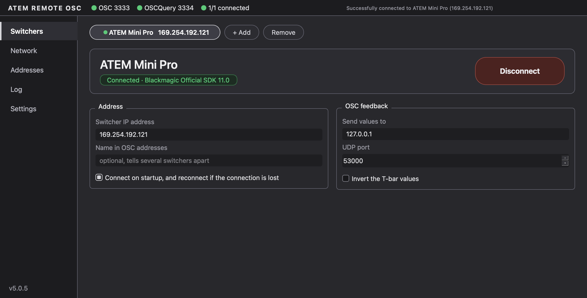

<div align="center">

# ATEMREMOTEOSC

### Drive Blackmagic ATEM switchers with OSC.

From TouchOSC, Max, QLab, Companion or any OSC software. Every address answers back with its value, and OSCQuery clients find it by themselves.

<!-- release-downloads:start -->
**LATEST VERSION · [v5.0.8](https://github.com/PixelStereo/AtemRemoteOSC/releases/tag/v5.0.8)**

[](https://github.com/PixelStereo/AtemRemoteOSC/releases/download/v5.0.8/AtemRemoteOSC-macos-v5.0.8.zip)&nbsp;&nbsp;[](https://github.com/PixelStereo/AtemRemoteOSC/releases/download/v5.0.8/AtemRemoteOSC-windows-v5.0.8-Setup.exe)
<!-- release-downloads:end -->

</div>

<p align="center">
  
</p>

- **Everything the switcher does**: program and preview, transitions, keyers, SuperSource, audio and Fairlight, MultiView, macros, recording, streaming, camera control.
- **Timed transitions of any length**, with easing, far beyond the 10 seconds of the switcher.
- **Feedback everywhere**: every change on the switcher is sent back as OSC.
- **OSCQuery**: sliders, ranges and live values appear by themselves in OSCQuery browsers.
- **Several switchers** at once, **macOS and Windows**, free and open source.

## Quick start

1. Download, open (on macOS, the first time: Control-click the app, **Open**), add your switcher's IP address, press **Connect**.
2. Send OSC to the computer's address on UDP port **3333**, for example `/atem/me/1/transition/auto`.
3. Receive the feedback on the port set in the app (53000 by default).

Every address is listed in the [reference](docs/reference.md), and in the app's *Addresses* page.

## Build

```sh
./build.sh
```

Needs Qt 6, CMake and a C++17 compiler. The Blackmagic SDK headers are in `sdk/`. Push a tag such as `v5.0.6` to publish the macOS and Windows downloads through GitHub Actions.

## Thanks

AtemRemoteOSC grew from [atemOSC](https://github.com/SteffeyDev/atemOSC), created by Daniel Büchele and maintained for years by Peter Steffey and many contributors. It is not meant to belittle their work, only to offer a different alternative, rewritten in Qt. Peter now sells atemOSC 5 at [atemosc.com](https://www.atemosc.com): please support him.

A young project: tell us what breaks. Built by [Pixel Stereo](https://pixelstereo.com).

## License

AGPL-3.0, see [LICENSE](LICENSE). The Blackmagic ATEM Switchers SDK headers in `sdk/` keep their own license notices.
