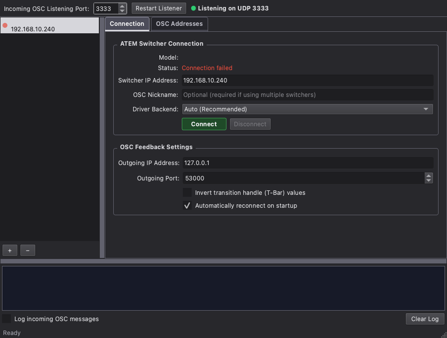

# AtemRemoteOsc



AtemRemoteOsc is a network proxy: it listens for commands following the [OSC protocol](http://opensoundcontrol.org/introduction-osc) and executes them on Blackmagic ATEM video switchers, and sends the switcher state back as OSC feedback.

## Where this comes from, and what changed

atemOSC was created by [Daniel Büchele](https://github.com/danielbuechele) and maintained for years by [Peter Steffey](https://github.com/SteffeyDev/atemOSC) with many contributors (Blair McMillan, John Barker and others). The last free and open-source release, **4.2**, is a **macOS-only** Objective-C++/Cocoa application built with Xcode, using the VVOSC framework and the Blackmagic SDK.

Peter Steffey has since moved atemOSC to a paid version 5. This fork starts from the open-source code of 4.2 and **changes course**: it is a complete rewrite in **C++17 / Qt 6** with CMake, kept free and open.

To avoid any confusion with the original project and its version numbers, this fork has its own name, **AtemRemoteOsc**, and starts again at **version 0**.

> **A word of thanks.** The aim of this project is not to belittle Peter Steffey's work, nor that of the other contributors. atemOSC exists, and is as good as it is, thanks to years of generous effort on their part, and everything here stands on the shoulders of that work. Anyone who wants the official, supported, actively developed atemOSC on macOS should go to [atemosc.com](https://www.atemosc.com) and support the original author. This fork simply offers a *different* alternative, with other priorities: cross-platform (Windows and Linux), free and open source, and a wider coverage of the Blackmagic SDK. Thank you, Peter, for all of it.


| | 4.2 (SteffeyDev, last open-source release) | AtemRemoteOsc (this fork) |
|---|---|---|
| Platforms | macOS | **macOS, Windows, Linux** |
| Language / UI | Objective-C++, Cocoa, Xcode | C++17, Qt 6 Widgets, CMake |
| OSC engine | VVOSC | Own implementation on `QUdpSocket` (messages and bundles) |
| Switcher access | Blackmagic SDK (macOS) | Blackmagic SDK 11.0 on macOS/Windows, **direct UDP protocol on Linux** (no Blackmagic software needed) |
| Feedback | Callback based, partial | Whole state polled and diffed, sent as soon as it changes |
| Releases | Manual, notarized | GitHub Actions builds for the three platforms on every `vX` tag |

The OSC address scheme of 4.2 is **kept**, so existing TouchOSC / Open Stage Control / QLab / OSCulator setups and the layouts in `samples/` keep working (default M/E aliases such as `/atem/usk/1/tie/toggle`, value-in-address form with TouchOSC press/release handling, `led/green|red`, `tie/set-next`, ...).

### What is new compared to 4.2

 - **Windows and Linux support** (Linux uses a built-in implementation of the ATEM UDP protocol on port 9910).
 - **Camera control and PTZ**: iris, focus, autofocus, gain, shutter, white balance, PTZ speed and presets, with feedback.
 - **Fairlight audio**: solo, analog preamp / phantom / low-cut, 6-band EQ, compressor, limiter, expander.
 - **MultiView**: layout, per-window source, safe area, VU meters.
 - **Display clock**: time of day, countdown, count-up, start/stop/reset, size, position, opacity.
 - **Recording / streaming**: ISO recording, disk switch, stream service, URL and key.
 - **More keyer control**: advanced chroma sample, mask top/bottom/left/right on USK and DSK, full SuperSource box crop and border.
 - **Converted video modes** on aux outputs and stills capture (SDK 11.0).
 - **Complete feedback**: every value above is reported, on change and on request.
 - **Partial updates**: changing one parameter of a group (EQ band, mask, clock layout, PTZ...) no longer resets the others.
 - **Auto reconnect**, connection on launch, per-switcher backend choice (SDK or direct network).
 - **Robust OSC decoding**: malformed packets and deeply nested bundles are rejected instead of misparsed.
 - Unit tests (`ctest`) covering OSC encoding/decoding, the ATEM packet layer, address handling and parameter merging.

## Current limitations

 - This rewrite is **young**. It compiles and its tests pass on macOS, but it has **not been validated against a real switcher yet**. The Windows build has never been compiled. Please report problems.
 - The **Linux direct-network backend** supports program/preview, transitions, keyers (on-air, tie, type, sources), downstream keyers, aux, macros, recording and streaming start/stop, classic audio, MultiView window sources and media player selection. Other features (Fairlight, camera, clock, SuperSource, HyperDeck, luma/chroma/fly/mask parameters) log "not available with the direct network backend" instead of acting. The protocol command codes were written from memory of the ATEM protocol and still have to be confirmed on hardware.
 - Not implemented yet: USK DVE border parameters, fly rate, `audio/output/balance`, DVE and stinger transition parameters, Fairlight and HyperDeck feedback.
 - Builds are not code-signed or notarized (macOS will show a Gatekeeper warning on first launch: right click, Open).

## Download

Prebuilt macOS (`.dmg`), Windows (`.zip`) and Linux (`.tar.gz`, requires Qt 6) packages are attached to each release on the [releases page](https://github.com/PixelStereo/AtemRemoteOsc/releases).

## Build from source

The Blackmagic SDK 11.0 headers needed on macOS and Windows are included in `sdk/` (they are distributed under Blackmagic's permissive license, notice kept in each file).

```bash
./build.sh            # installs dependencies (Homebrew / apt / dnf / pacman / zypper), builds and runs the tests
```

Options: `--debug`, `--clean`, `--no-deps`, `--no-test`. On Windows, run it from Git Bash with Qt and Visual Studio installed and set `QT_DIR` (for example `QT_DIR=C:/Qt/6.7.3/msvc2019_64 ./build.sh --no-deps`).

Manually: Qt 6.2+ (Core, Gui, Widgets, Network, Test), CMake 3.16+, a C++17 compiler.

```bash
cmake -S . -B build -DCMAKE_BUILD_TYPE=Release
cmake --build build --parallel
ctest --test-dir build --output-on-failure
```

### Releasing

Push a tag starting with `v` (for example `git tag v0.1.0 && git push origin v0.1.0`). The workflow in `.github/workflows/release.yml` builds, tests and packages the three platforms and publishes the GitHub release.

## Setup and Usage

After launching the application, enter the IP address of the switcher, choose the backend (the official SDK on macOS / Windows, direct network on Linux) and which local port to listen on (default 3333), and then send OSC commands to the IP address of the computer running AtemRemoteOsc that port.  If you set an outgoing IP address and port, AtemRemoteOsc will send status updates and feedback OSC messages to the IP address and port you specified.

**If you are sending AtemRemoteOsc messages from a queueing software or translation software on the same computer that AtemRemoteOsc is running on**, make sure to send messages to `127.0.0.1` (localhost) on the port that AtemRemoteOsc is listening on.

**If you are sending AtemRemoteOsc messages from another device**, you will need to send it to the IP address of the computer running AtemRemoteOsc on the port that AtemRemoteOsc is listening on.  You can find the IP address of your computer in the system network settings, or by running `ifconfig` (macOS / Linux) or `ipconfig` (Windows) in a terminal.

**If you would like to send OSC from AppleScript or Terminal commands**, you can download and use the [sendosc](https://github.com/yoggy/sendosc) command.  See the [actionscript example](samples/controllermate-actionscript.txt) in this repository for an example of using AppleScript and sendOSC.  SendOSC also enables using AtemRemoteOsc with [ControllerMate](http://www.orderedbytes.com/controllermate/) and [X-keys](http://xkeys.com/XkeysKeyboards/index.php).

**If you would like to control your switcher using a MIDI board or device**, consider pairing this software with [OSCulator](https://osculator.net) or [MidiPipe](http://www.subtlesoft.square7.net/MidiPipe.html).  If you would like to control AtemRemoteOsc directly using MIDI, comment on [Issue #111](https://github.com/SteffeyDev/atemOSC/issues/111) to let us know.

**If you would like to control your switcher using a mobile device**, you can use [TouchOSC](https://hexler.net/products/touchosc) or [Open Stage Control](https://openstagecontrol.ammd.net).

 - Open Stage Control Layout by Peter Steffey: [samples/open-stage-control.json](samples/open-stage-control.json)
 - TouchOSC Layout (iPad) by Peter Steffey: [samples/ipad-layout.touchosc](samples/ipad-layout.touchosc)
 - TouchOSC Layout (iPad) by mkcologne: [https://github.com/mkcologne/atemMiniTouchOSC](https://github.com/mkcologne/atemMiniTouchOSC)
 - TouchOSC Layout (iPhone): [samples/iphone-layout.touchosc](samples/iphone-layout.touchosc)

## Videos & Guides

**Usage with Ableton Live and OSCulator (MIDI) by Jake Gosselin**: [https://www.youtube.com/watch?v=Xhbk1epkrLc](https://www.youtube.com/watch?v=Xhbk1epkrLc)

**Usage with QLab by Jack Phelan**: [https://jackp.svbtle.com/atem-mini-qlab-and-osc](https://jackp.svbtle.com/atem-mini-qlab-and-osc)

**Usage with TouchOSC by John Barker**: [https://www.youtube.com/watch?v=jX7YI-DTMxM](https://www.youtube.com/watch?v=jX7YI-DTMxM)

**Usage with OSCulator (MIDI) by John Barker**: [https://www.youtube.com/watch?v=HQm2KZYcPws](https://www.youtube.com/watch?v=HQm2KZYcPws)

**Usage with OSCulator (MIDI) by Morgan Warf**: [https://www.youtube.com/watch?v=ooaOz5Uytxs](https://www.youtube.com/watch?v=ooaOz5Uytxs)

**Usage with ProPresenter and OSCulator (MIDI) by Tiffany Howard**: [https://www.youtube.com/watch?v=dHwSHa8UWVw](https://www.youtube.com/watch?v=dHwSHa8UWVw)

----------

## OSC API

The full list of the OSC-addresses available for your switcher can be obtained by going to the "OSC Addresses" tab once you've connected AtemRemoteOsc to your switcher. The list below is just an overview of what the addresses may look like for a generic switcher.

All addresses must start with `/atem/`.  AtemRemoteOsc will ignore all OSC commands it receives whose address does not start with `/atem/`.

### Multi-switcher support

If you only want to connect to a single ATEM switcher, leave the nickname field blank and use the addresses below as normal. By default, all commands without a nickname will be sent to the first switcher with no nickname.

If you connect multiple switchers to AtemRemoteOsc, you will need to provide a nickname for each switcher and use that nickname in the address to specify which switcher to send the command to. If you add a nickname to a switcher, you **must** send the nickname in the address, and all feedback messages will contain the nickname in the address.

For example, `/atem/my-switcher-1/transition/auto` will trigger an automatic transition on the switcher whose nickname is `my-switcher-1`

### Program and Preview Selection

By default, commands will be sent to the first mix effect block (M/E).  To send commands on other mix effect blocks, use the address: `/atem/me/$i/program <number>`, where `$i` is 1, 2, 3, or 4

 - **Black** `/atem/program 0`

 - **Cam 1** `/atem/program 1`
 - **Cam 2** `/atem/program 2`
 - **Cam 3** `/atem/program 3`
 - **Cam 4** `/atem/program 4`
 - **Cam 5** `/atem/program 5`
 - **Cam 6** `/atem/program 6`
 - and so on...

 - **Color Bars** `/atem/program 1000`
 - **Color 1** `/atem/program 2001`
 - **Color 2** `/atem/program 2002`
 - **Media 1** `/atem/program 3010`
 - **Media 2** `/atem/program 3020`
 - **Key 1 Mask** `/atem/program 4010`
 - **DSK 1 Mask**: `/atem/program 5010`
 - **DSK 2 Mask**: `/atem/program 5020`
 - **Clean Feed 1** `/atem/program 7001`
 - **Clean Feed 2** `/atem/program 7002`
 - **Auxiliary 1** `/atem/program 8001`
 - and so on...

For preview selection `/atem/preview $i` can be used.

Also supports sending the input in the address instead of as a value (e.g. `/atem/program/5`)

Feedback: Enabled for all values

Note: The actual numbers vary greatly from device to device, be sure to check the in-app address menu

Note: You can fetch the names of each input by sending the `/atem/send-status` command (detailed later), this will return the short names of each input to `/atem/input/$i/short-name` and the long names to `/atem/input/$i/long-name`. After the initial fetch, you will also recieve updates when the short or long name is changed in ATEM Software Control.

### Transition Control

By default, commands will be sent to the first mix effect block (M/E).  To send commands on other mix effect blocks, use the address: `/atem/me/$i/transition/...`, where `$i` is 1, 2, 3, or 4

 - **T-bar** `/atem/transition/bar <0-1>`
 - **Cut** `/atem/transition/cut`
 - **Auto** `/atem/transition/auto`
 - **Fade to Black Toggle** `/atem/transition/ftb`
 - **Preview Transition** `/atem/transition/preview <true|false>`
 - **T-bar Reset to Transition Start Position** `/atem/transition/bar/reset`
 - **Set Transition Position** `/atem/transition/position <0-1>`

To set the transition type of the Auto transition:

 - **Mix** `/atem/transition/type mix`
 - **Dip** `/atem/transition/type dip`
 - **Wipe** `/atem/transition/type wipe`
 - **Stinger** `/atem/transition/type sting`
 - **DVE** `/atem/transition/type dve`
 - Also supports sending the type in the address instead of as a string value (e.g. `/atem/transition/type/dve`)

 To set rate for Auto transition:

 - **Currently selected type** `/atem/transition/rate <float>`
 - **Mix** `/atem/transition/mix/rate <float>`
 - **Dip** `/atem/transition/dip/rate <float>`
 - **Wipe** `/atem/transition/wipe/rate <float>`
 - **DVE** `/atem/transition/dve/rate <float>`

Feedback: Enabled for `/atem/transition/bar` and `/atem/transition/position`

### Auxiliary Source Selection

 - **Set Aux $i source to $x** `/atem/aux/$i $x`
     - Where `$x` is an integer value that is a valid program source, and can be 1-6 depending on the capability of your ATEM switcher. Check the Help Menu for the correct values.
     - e.g. `/atem/aux/1 1` to set Aux 1 output to source 1 (Camera 1)

 Feedback: Enabled

### Upstream Keyers

By default, commands will be sent to the first mix effect block (M/E).  To send commands on other mix effect blocks, use the address: `/atem/me/$i/usk/...`, where `$i` is 1, 2, 3, or 4

 - **Set Tie BKGD** `/atem/usk/0/tie <true|false>`
     - Send a value of 1 to enable tie, and 0 to disable
 - **Toggle Tie BKGD** `/atem/usk/0/tie/toggle`
 - **Set On-Air Upstream Keyer $i** `/atem/usk/$i/on-air <true|false>`
     - Send a value of true to cut the USK on-air, and a value of false to cut it off-air
 - **Cut Toggle On-Air Upstream Keyer $i** `/atem/usk/$i/on-air/toggle`
 - **Set Tie Upstream Keyer $i** `/atem/usk/$i/tie <true|false>`
     - Send a value of true to enable tie, and false to disable
 - **Toggle Tie Upstream Keyer $i** `/atem/usk/$i/tie/toggle`
 - **Set Upstream Keyer $i for Next Scene** `/atem/usk/$i/tie/set-next <true|false>`
     - Send a boolean value of true to show the USK after next transition, and false if you don’t want to show the USK after next transition
     - e.g. If USK 1 is on air, `/atem/usk/1/tie/set-next true` will untie USK 1 so that it remains on, while `/atem/usk/1/tie/set-next false` will tie USK 1 so that it will go off air after the next transition.
 - **Set Key type for Upstream Keyer $i** `/atem/usk/$i/type <luma|chroma|pattern|dve>`
     - Also supports sending the type in the address instead of as a string value (e.g. `/atem/usk/$i/type/luma`)

#### USK Source
 - **Set Fill Source for Upstream Keyer $i** `/atem/usk/$i/source/fill <int>`
     - Int value should be the ID of the input to set as the source (from in-app help menu, under the Sources section)
 - **Set Key (cut) Source for Upstream Keyer $i** `/atem/usk/$i/source/cut <int>`
     - Int value should be the ID of the input to set as the source (from in-app help menu, under the Sources section)

#### USK Luma Parameters
 - **Set Clip Luma Parameter for Upstream Keyer $i** `/atem/usk/$i/luma/clip <float>`
     - Float value should be between 0.0 (for 0%) and 1.0 (for 100%)
 - **Set Gain Luma Parameter for Upstream Keyer $i** `/atem/usk/$i/luma/gain <float>`
     - Float value should be between 0.0 (for 0%) and 1.0 (for 100%)
 - **Set Pre-Multiplied Luma Parameter for Upstream Keyer $i** `/atem/usk/$i/luma/pre-multiplied <bool>`
 - **Set Inverse Luma Parameter for Upstream Keyer $i** `/atem/usk/$i/luma/inverse <bool>`

#### USK Chroma Parameters
 - **Set Hue Chroma Parameter for Upstream Keyer $i** `/atem/usk/$i/chroma/hue <float>`
     - Float value should be between 0.0 and 359.9
 - **Set Gain Chroma Parameter for Upstream Keyer $i** `/atem/usk/$i/chroma/gain <float>`
     - Float value should be between 0.0 (for 0%) and 1.0 (for 100%)
 - **Set Y Suppress Chroma Parameter for Upstream Keyer $i** `/atem/usk/$i/chroma/y-suppress <float>`
     - Float value should be between 0.0 (for 0%) and 1.0 (for 100%)
 - **Set Lift Chroma Parameter for Upstream Keyer $i** `/atem/usk/$i/chroma/lift <float>`
     - Float value should be between 0.0 (for 0%) and 1.0 (for 100%)
 - **Set "Narrow Chroma Key Range" Parameter for Upstream Keyer $i** `/atem/usk/$i/chroma/narrow <bool>`

#### USK DVE Parameters
 - **Set DVE Border Enabled for Upstream Keyer $i** `/atem/usk/$i/dve/enabled <true|false>`
 - **Set DVE Border Outer Width for Upstream Keyer $i** `/atem/usk/$i/dve/border-width-outer <float>`
 - Other values supported are: `border-width-inner`, `border-softness-outer`, `border-softness-inner`, `border-opacity`, `border-hue`, `border-saturation`, and `border-luma`

#### USK Fly Parameters
 - **Enable Flying Key for Upstream Keyer $i** `/atem/usk/$i/fly/enable <true|false>`
 - **Set Fly Rate for Upstream Keyer $i** `/atem/usk/$i/fly/rate <int>`
 - **Set X Position for Upstream Keyer $i** `/atem/usk/$i/fly/position-x <float>`
 - Other values supported are: `position-y`, `size-x`, `size-y`
 - **Set Rotation for Upstream Keyer $i** `/atem/usk/$i/fly/position-x <float>`
     - Float value is the rotation in degrees
 - **Reset Position, Size, & Rotation to defaults for Upstream Keyer $i** `/atem/usk/$i/fly/reset`
 - **Reset Position, Size, & Rotation to full screen with no rotation for Upstream Keyer $i** `/atem/usk/$i/fly/clear`

 #### USK Mask Parameters
 - **Set Mask ON/OFF for Upstream Keyer $i** `/atem/usk/$i/mask/enabled <true|false>`
 - **Reset Mask Values for Upstream Keyer $i** `/atem/usk/$i/mask/reset
 - **Set Top Mask Parameter for Upstream Keyer $i** `/atem/usk/$i/mask/top <float>`
     - Float value should be between -9.0 and 9.0
 - **Set Bottom Mask Parameter for Upstream Keyer $i** `/atem/usk/$i/mask/bottom <float>`
     - Float value should be between -9.0 and 9.0
- **Set Left Mask Parameter for Upstream Keyer $i** `/atem/usk/$i/mask/left <float>`
     - Float value should be between -16.0 and 16.0
- **Set Right Mask Parameter for Upstream Keyer $i** `/atem/usk/$i/mask/right <float>`
     - Float value should be between -16.0 and 16.0

Where `$i` can be 1, 2, 3, or 4 depending on the capability of your ATEM switcher

Feedback: Enabled for '/atem/usk/$i/on-air', '/atem/usk/$i/tie', '/atem/usk/$i/source/\*', '/atem/usk/$i/luma/\*', and '/atem/usk/$i/chroma/\*'

### Downstream Keyers

 - **Set On-Air Downstreamkeyer $i** `/atem/dsk/$i/on-air <true|false>`
     - Send a value of true to cut the DSK on-air, and a value of false to cut it off-air
 - **Auto Toggle On-Air Downstreamkeyer $i** `/atem/dsk/$i/on-air/auto`
 - **Cut Toggle On-Air Downstreamkeyer $i** `/atem/dsk/$i/on-air/toggle`
 - **Set Tie Downstreamkeyer $i** `/atem/dsk/$i/tie <true|false>`
     - Send a value of true to enable tie, and false to disable
 - **Toggle Tie Downstreamkeyer $i** `/atem/dsk/$i/tie/toggle`
 - **Set Downstreamkeyer $i for Next Scene** `/atem/dsk/$i/tie/set-next <true|false>`
     - Send a value of true to show the DSK after next transition, and false if you don’t want to show the DSK after next transition
     - e.g. If DSK1 is on air, `/atem/dsk/1/tie/set-next true` will untie DSK1 so that it remains on, while `/atem/dsk/1/tie/set-next false` will tie DSK1 so that it will go off air after the next transition.

#### DSK Source
 - **Set Fill Source for Downstreamkeyer $i** `/atem/dsk/$i/source/fill <int>`
     - Int value should be the ID of the input to set as the source (from in-app help menu, under the Sources section)
 - **Set Key (cut) Source for Downstreamkeyer $i** `/atem/dsk/$i/source/cut <int>`
     - Int value should be the ID of the input to set as the source (from in-app help menu, under the Sources section)

#### DSK Parameters
 - **Set Clip Parameter for Downstreamkeyer $i** `/atem/dsk/$i/clip <float>`
     - Float value should be between 0.0 (for 0%) and 1.0 (for 100%)
 - **Set Gain Parameter for Downstreamkeyer $i** `/atem/dsk/$i/gain <float>`
     - Float value should be between 0.0 (for 0%) and 1.0 (for 100%)
 - **Set Pre-multiplied Parameter for Downstreamkeyer $i** `/atem/dsk/$i/pre-multiplied <true|false>`
 - **Set Invert Parameter for Downstreamkeyer $i** `/atem/dsk/$i/inverse <true|false>`
 - **Set Rate Parameter for Downstreamkeyer $i** `/atem/dsk/$i/rate <int>`
    - Int value is number of frames, so 30 is 1 second and 60 is 2 seconds (given 30 fps base value)
earch)- **Enable Mask for Downstreamkeyer $i** `/atem/dsk/$i/mask/enabled <true|false>`
 - **Reset Mask for Downstreamkeyer $i** `/atem/dsk/$i/mask/reset`
 - **Set Mask for Downstreamkeyer $i** `/atem/dsk/$i/mask/[left|right|top|bottom] <float>`
    - For left: `/atem/dsk/$i/mask/left <float>`
    - For right: `/atem/dsk/$i/mask/right <float>`
    - For top: `/atem/dsk/$i/mask/top <float>`
    - For bottom: `/atem/dsk/$i/mask/bottom <float>`

Where `$i` can be 1, 2, 3, or 4 depending on the capability of your ATEM switcher

Feedback: Enabled for '/atem/dsk/$i/on-air' and '/atem/dsk/$i/tie'

### Audio

Supports both standard and Fairlight audio mixers.

 - **Change Gain for Audio Input $i** `/atem/audio/input/$i/gain $x`
     - Where `$x` is the gain in decibels (dB), ranging from `-60` to `6`
     - e.g. `/atem/audio/input/2/gain -30.0`
     - For Fairlight audio input in dual mono mode, will set gain for both left & right.  To control the left and right channels individually, use the addresses `/atem/audio/input/$i/left/gain` and `/atem/audio/input/$i/right/gain`.
 - **Change Balance for Audio Input $i** `/atem/audio/input/$i/balance $x`
     - Where `$x` is the balance, `-1.0` for full left up to `1.0` for full right
     - e.g. `/atem/audio/input/2/balance 0.4`
     - For Fairlight audio input in dual mono mode, will set balance for both left & right.  To control the left and right channels individually, use the addresses `/atem/audio/input/$i/left/balance` and `/atem/audio/input/$i/right/balance`.
 - **Change Mix Option for Audio Input $i** `/atem/audio/input/$i/mix <string>`
     - Where `<string>` is 'on', 'off', or 'afv' (audio follow video)
     - e.g. `/atem/audio/input/2/mix 'afv'`
     - Also supports sending mix option in address (e.g. `/atem/audio/input/$i/mix/afv`)
     - For Fairlight audio input in dual mono mode, will set mix option for both left & right.  To control the left and right channels individually, use the addresses `/atem/audio/input/$i/left/mix` and `/atem/audio/input/$i/right/mix`.
 - **Change Gain for Audio Output (Mix)** `/atem/audio/output/gain $x`
     - Where `$x` is the gain in decibels (dB), ranging from `-60` to `6`
     - e.g. `/atem/audio/output/gain -30.0`
 - **Change Balance for Audio Output** `/atem/audio/output/balance $x`
     - Where `$x` is the balance, `-1.0` for full left up to `1.0` for full right
     - e.g. `/atem/audio/output/balance 0.4`
     - Not supported for Fairlight audio mixer

Feedback: Enabled for all values

Additional TouchOSC feedback - Every time the mix changes, 3 messages are sent:
 - `/atem/audio/input/$i/mix/afv` with a float value of 1.0 if the current audio mode is AFV, or 0.0 otherwise
 - `/atem/audio/input/$i/mix/on` with a float value of 1.0 if the current audio mode is ON, or 0.0 otherwise
 - `/atem/audio/input/$i/mix/off` with a float value of 1.0 if the current audio mode is OFF, or 0.0 otherwise

### Media Players

 - **Set Media Player $i source to Clip $x** `/atem/mplayer/$i/clip $x`
     - Where `$i` can be 1 or 2, and `$x` can be 1 or 2 depending on the capability of your ATEM switcher
     - e.g. `/atem/mplayer/2/clip 1`
 - **Set Media Player $i source to Still $x** `/atem/mplayer/$i/still $x`
     - Where `$i` can be 1 or 2, and `$x` can be 1-20 depending on the capability of your ATEM switcher
     - e.g. `/atem/mplayer/1/still 5`

Feedback: None

### SuperSource (when available)

 - **Toggle SuperSource Box $i enabled** `/atem/supersource/$i/enabled <true|false>`
     - Send a value of 1 to enable, and 0 to disable
 - **Set SuperSource Box $i source to input $x** `/atem/supersource/$i/source $x`
     - Where `$x` is a valid program source. Check the Help Menu for the correct values.
 - Other options are available. Check the Help Menu in the app for the full list.

Feedback: None

### Macros

 - Macros should be recorded within the ATEM Control Panel software.
 - Macros are stored within the ATEM in a 0-index array
     - This means that to access the first recorded Macro, you should use an index `$i` of `0`, to access the second recorded Macro, you should use an index of `1` etc.
 - Get the Maximum Number of Macros: `/atem/macros/max-number`
     - Returns an `int` of the maximum number of Macros supported by your ATEM
     - Access to these Macros should be used via an index of `n-1`
 - Stop the currently active Macro (if any): `/atem/macros/stop`
 - Get the Name of a Macro: `/atem/macros/$i/name`
     - Returns a `string` with the name, or "" if the Macro is invalid
 - Get the Description of a Macro: `/atem/macros/$i/description`
     - Returns a `string` with the description, or "" if the Macro is invalid
 - Get whether the Macro at index $i is valid: `/atem/macros/$i/is-valid`
     - Returns an `int` of `0|1` to indicate whether the requested Macro is valid
 - Run the Macro at index $i: `/atem/macros/$i/run`
     - Returns an `int` of `0|1` to indicate whether the requested Macro was executed. A `0` will be returned if the Macro is invalid, or does not exist

Feedback: Enabled for `/atem/macros/max-number`, `/atem/macros/$i/name`, `/atem/macros/$i/description`, and `/atem/macros/$i/is-valid`. Also available On-Request (you can send the command to get the value in a return message)
The current status of each macro is also sent out to `/atem/macros/$i/status`, with a string value of `idle`, `running`, or `waiting`.

### HyperDeck

 - **Select Clip on HyperDeck $i** `/atem/hyperdeck/$i/clip <int>`
     - e.g. `/atem/hyperdeck/1/clip 5`
 - **Play Selected Clip on HyperDeck $i** `/atem/hyperdeck/$i/play`
 - **Record New Clip on HyperDeck $i** `/atem/hyperdeck/$i/record`
 - **Stop Play/Record on HyperDeck $i** `/atem/hyperdeck/$i/stop`
 - **Shuttle Clip on HyperDeck $i** `/atem/hyperdeck/$i/shuttle $x`
     - Where `$x` is an integer value specifying the speed to start playback at, expressed as a percentage
     - e.g. `/atem/hyperdeck/1/shuttle 200` = 2x speed
     - e.g. `/atem/hyperdeck/1/shuttle 50` = 1/2 speed
     - e.g. `/atem/hyperdeck/1/shuttle 0` = stopped
 - **Jog Clip on HyperDeck $i** `/atem/hyperdeck/$i/jog $x`
     - Where `$x` is an integer value specifying the number of frames to jump forward or backward in the selected clip
 - **Jump to clip time $x on HyperDeck $i** `/atem/hyperdeck/$i/clip-time $x`
     - Where `$x` is a string in the format 'hh:mm:ss' (h = hour, m = minute, s = second)
     - e.g. `/atem/hyperdeck/1/clip-time 00:05:00` = jump 5 minutes into the clip
 - **Jump to timeline time $x on HyperDeck $i** `/atem/hyperdeck/$i/timeline-time $x`
 - **Turn on/off single-clip playback mode on HyperDeck $i** `/atem/hyperdeck/$i/single-clip <true|false>`
 - **Turn on/off looped playback mode on HyperDeck $i** `/atem/hyperdeck/$i/loop <true|false>`

Feedback: Enabled for `clip`, `clip-time`, `timeline-time`, `state`, `single-clip`, and `loop`.  The state of the HyperDeck is available as a string value at `/atem/hyperdeck/$i/state`, and is sent out automatically when the state changes. State will be one of `play`, `record`, `shuttle`, `idle`, or `unknown`.

### Recording

 - **Start recording to external media** `/atem/recording/start`
 - **Stop recording to external media** `/atem/recording/stop`
 - **Switch which external media disk is used for recording** `/atem/recording/switch-disk`
 - **Change recording filename** `/atem/recording/filename <string>`

Feedback: Recording state sent to address `/atem/recording/state`, will contain a string that is one of `idle` | `recording` | `stopping` | `error`. For simplicity, the boolean value indicating whether or not the recording is active is sent to the address `/atem/recording/active`.

### Streaming

 - **Start Streaming** `/atem/stream/start`
 - **Stop Streaming** `/atem/stream/stop`

Feedback: Stream state sent to address `/atem/stream/state`, will contain a string that is one of `idle` | `connecting` | `streaming` | `stopping` | `error`. For simplicity, the boolean value indicating whether or not the recording is active is sent to the address `/atem/stream/active`.

### Other

  - **Request all feedback available** `/atem/send-status`
     - This will query the switcher and send back the status for the program/preview, transition control, keyers, and macros
     - AtemRemoteOsc will also `/atem/led/green` with a float value of 1.0 if connected and 0.0 if disconnected, and `/atem/led/red` with the inverse float value.  These `led` messages are also sent whenever the connection status changes.
  - **Request only Program/Preview/Bar status** `/atem/me/$i/send-status`
     - Where `$i` is an integer value specifying the M/E to get the status of
     - This will query the switcher and send back the status for only program/preview, bar, and preview
  - This can be used when a new OSC client device is brought online, so that it gets the current status of the system

### Camera Control & PTZ (new)

Requires the SDK backend (macOS / Windows). `$i` is the camera number configured on the switcher.

 - **Iris** `/atem/camera/$i/iris <0.0-1.0>`
 - **Focus** `/atem/camera/$i/focus <0.0-1.0>`
 - **One-shot autofocus** `/atem/camera/$i/autofocus`
 - **Gain in dB** `/atem/camera/$i/gain <int>`
 - **Shutter speed** `/atem/camera/$i/shutter <int>` (denominator: `60` means 1/60 s)
 - **White balance in Kelvin** `/atem/camera/$i/white-balance <int>`
 - **PTZ speed** `/atem/camera/$i/ptz/pan`, `/ptz/tilt`, `/ptz/zoom` with `<-1.0 to 1.0>` (`0` stops the movement)
 - **Recall PTZ preset** `/atem/camera/$i/ptz/recall <int>`

Feedback: iris, focus, gain, shutter and white-balance.

### Fairlight Audio, EQ & Dynamics (new)

On top of gain / balance / mix, per audio input `$i`:

 - **Solo** `/atem/audio/input/$i/solo <bool>`
 - **Analog input** `/atem/audio/input/$i/preamp <dB>`, `/mic-level <bool>`, `/phantom <bool>`, `/low-cut <bool>`
 - **EQ band `$b`** (0-5) `/atem/audio/input/$i/eq/$b/enabled|freq|gain|q` and `/atem/audio/input/$i/eq/reset`
 - **Compressor** `/atem/audio/input/$i/compressor/enabled|threshold|ratio|attack|release`
 - **Limiter** `/atem/audio/input/$i/limiter/enabled|threshold|attack|release`
 - **Expander / gate** `/atem/audio/input/$i/expander/enabled|threshold|range|ratio`

Several addresses map to one SDK call that takes all the parameters of a group (an EQ band, the compressor, a mask...). AtemRemoteOsc keeps the last known values of each group, so you can change one parameter at a time. Parameters never sent and never reported by the switcher use neutral defaults.

### MultiView (new)

 - **Layout** `/atem/multiview/$m/layout <top|bottom|left|right>` (more layouts on SDK versions that expose them)
 - **Window source** `/atem/multiview/$m/window/$w/source <int>`
 - **Safe area** `/atem/multiview/$m/safe-area <bool>`, **VU meters** `/atem/multiview/$m/meters <bool>`

### Display Clock (new)

 - `/atem/clock/enabled <bool>`, `/atem/clock/mode <timeofday|countdown|countup>`
 - `/atem/clock/start`, `/atem/clock/stop`, `/atem/clock/reset`
 - `/atem/clock/time <HH:MM:SS>`, `/atem/clock/size`, `/atem/clock/opacity`, `/atem/clock/x`, `/atem/clock/y`

### Recording, Streaming & Media (new)

 - `/atem/recording/iso <bool>`, `/atem/recording/switch-disk`
 - `/atem/stream/service <string>`, `/atem/stream/url <string>`, `/atem/stream/key <string>`
 - `/atem/mplayer/capture` captures the current output into the media pool
 - `/atem/aux/$i/converted-videomode <int>` sets the video mode of a converted aux output (SDK 11.0)

### More keyer & SuperSource addresses (new)

 - `/atem/usk/$i/chroma/sample-x|sample-y` (advanced chroma sample position), `/atem/usk/$i/mask/top|bottom|left|right`
 - `/atem/dsk/$i/mask/top|bottom|left|right`
 - `/atem/supersource/box/$i/x|y|size|cropped|crop-top|crop-bottom|crop-left|crop-right|crop-reset` (the legacy `/atem/supersource/$i/enabled|source` still work)
 - `/atem/supersource/border/enabled|width-in|width-out|softness-in|softness-out|hue|saturation|luma`

### Feedback

AtemRemoteOsc reads the whole switcher state every 100 ms and sends an OSC message for every value that changed, plus everything on connection and on `/atem/send-status`. Feedback covers M/E (program, preview, T-bar, FTB, transition type/rate/preview), upstream keyers (on-air, tie, type, sources, luma, chroma, mask, fly), downstream keyers, aux, SuperSource boxes, audio, MultiView, display clock, recording, streaming, macros, camera control and input names.

### Type Casting

For your convenience, AtemRemoteOsc will cast certain types to the correct type for certain endpoints

 - If you pass an int or float value of 0 to a boolean method, the 0 will be interpreted as false
 - If you pass an int or float value of 1 to a boolean method, the 1 will be interpreted as true
 - If you pass an int value to an endpoint that requires a float, it will be properly converted (and vice-versa)

### TouchOSC Support

Due to the limited capabilities of the TouchOSC client, AtemRemoteOsc supports an alternative form of passing values.  For any method listed above that requires a string or int value, you can pass the string or int as part of the address instead of as a value.  For example, you can send `/atem/transition/type/wipe` instead of `/atem/transition/type wipe`, or send `/atem/usk/1/source/fill/3` instead of `/atem/usk/1/source/fill 3`.  Additionally, any command sent with one of these alternative addresses and a float value of `0.0` will be ignored, as that represents a button release and commonly causes issues.  If you would like to trigger a change on button release instead of button press, simply flip the values in the TouchOSC Editor.

----------

## Common Issues

### I want to use \<insert feature here\> that AtemRemoteOsc does not support yet

#### Problem

A few features are still missing (see [Current limitations](#current-limitations)), most notably DVE/stinger transition parameters and some Fairlight and HyperDeck feedback.

#### Solution

You are free to open an issue or comment on and existing issue, but the quickest solution for you is to create a **macro** in ATEM Software Control that accomplishes the task you would like and call the **macro** using AtemRemoteOsc.

### Auto and cut commands don’t seem to work, or look buggy, when combining AtemRemoteOsc with MIDI control

#### Problem
A lot of MIDI controls send two signals when a button is pressed, one signal when you press down, and another when you release. If you connect the button the `/atem/transition/auto` or `cut`, AtemRemoteOsc recieves both events and attempts to send the transition command to the switcher twice. This can cause buggy behavior or just not work at all.

#### Solution
Tune your MIDI software to send only one of the two signals, either ok button press (rising edge) or button release (falling edge). See [#120](https://github.com/SteffeyDev/atemOSC/issues/120) for instructions for OSCulator.

### I want to send feedback messages to multiple devices with different IP address

#### Problem
Occasionally, you may want to send output messages to many devices on the same network, but this does not seem possible because the feedback IP address field only accepts one IP address

#### Solution
Set the IP address to be the broadcast address for your network.  This will cause feedback messages to be sent to every device on the network.  For a typical network, the broadcast address is calculated by replacing the last octet with `255` (e.g. for a `192.168.1.x` network, the broadcast address is `192.168.1.255`).  However, the broadcast address may be different if the subnet mask is not `255.255.255.0`.  You may be able to use [this subnet calculator](https://remotemonitoringsystems.ca/broadcast.php) to calculate the broadcast address for your network.

### I'm having issues connecting to my switcher, or my switcher is connected but certain features don't work

#### Problem
There are a myriad of issues that can come up with connecting AtemRemoteOsc to your ATEM switcher.  Even once you get it connected, sometimes certain features that are supported by your switcher (e.g. recording) do not work with AtemRemoteOsc.

#### Solution
If possible, upgrade your switcher's firmware to the latest version supported, and on macOS and Windows (SDK backend), upgrade the version of ATEM Software Control installed on the computer running AtemRemoteOsc to match the switcher; on Linux, make sure UDP port 9910 is reachable. AtemRemoteOsc does not have any strong ties to the version of your ATEM switcher, so often the issue is that the ATEM Software Control version is out of sync with the ATEM switcher's firmware version, and making those version's match may solve the issue AtemRemoteOsc is having. If that doesn't fix it, try to find and use the latest version of AtemRemoteOsc that supports the switcher firmware version you are running.  If you are stuck on an older firmware version, you may have to use a previous version of AtemRemoteOsc.

-----------

## Contributing

I welcome pull requests, but recommend that you open an issue first so that we can discuss the bug or feature before you implement it.

----------

## Acknowledgements

 - Project originally created by [Daniel Büchele](https://github.com/danielbuechele), then maintained by [Peter Steffey](https://github.com/SteffeyDev) and contributors: see the [upstream repository](https://github.com/SteffeyDev/atemOSC) and the git history.
 - The Qt rewrite builds on the [Blackmagic ATEM Switchers SDK](https://www.blackmagicdesign.com/developer/) (headers included under their license) and [Qt](https://www.qt.io).
 - Program icon based heavily on the ATEM Software Control icon by [Blackmagic Design](http://www.blackmagicdesign.com).
